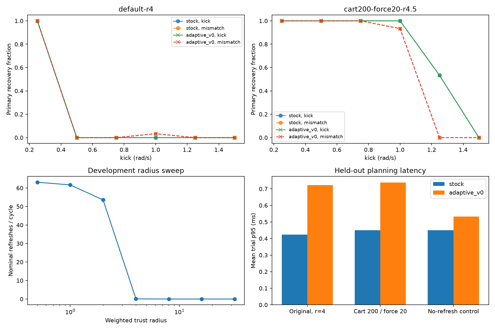

# Cart-pole trigger tuning and parameter study

**Conclusion: radius tuning removes most excessive refresh work, but the current V0 adaptive controller still provides no measured recovery advantage over stock RMPPI on these cart-pole experiments. Use stock RMPPI for the tested settings.** A larger radius is an empirical compute-load setting; it does not establish that a gain is mathematically invalid whenever a refresh fires.

The study ran **2,838 trials**, including calibration, parameter exploration, smoke checks, and **1,620 frozen evaluation trials**. All final comparisons used previously unused seeds 5000-5029. Controller, feedback, and kernel code remained unchanged from `7c54a0f`; only the benchmark harness and analysis were extended. Both modes apply the corrected plant-side feedback. The primary full-state recovery criterion remains unchanged throughout.

## Trigger calibration

The distance test uses weights `[1, 0.1, 1, 0.1]` and wraps pole-angle differences. Radius 0.5 caused about 63 nominal refreshes per planning cycle. Calibration selected the smallest tested radius giving at most 0.1 nominal refresh/cycle with no nominal budget hits:

| Shared cart-pole setting | Selected radius | Held-out nominal refreshes/cycle | Nominal budget-hit fraction |
| --- | ---: | ---: | ---: |
| Original: cart weight 50, force limit 10 N | 4.0 | 0.075 | 0 |
| Cart weight 200, force limit 20 N | 4.5 | 0.010 | 0 |

For the original setup, this is roughly a **99.9% reduction** from the radius-0.5 nominal refresh rate. Radius 8 suppressed every refresh in the initial 1 rad/s calibration cases, so simply making the radius larger eventually turns the feature off. The selected values are stored in [tuned_configs.json](adaptive_rmppi_validation/cartpole_tuning/tuned_configs.json), not promoted to a general controller default.

## Exploration and final evaluation

Development experiments covered horizons of 1, 2, and 3 seconds; force limits of 10 and 20 N; cart weights of 50, 100, 200, and 500; sampling standard deviations of 2.5, 5, and 7.5; lambda 0.25 and 1; one and three DDP iterations; and refresh budgets of 8 and 64. Not every combination was evaluated. Seventeen parameter-screen/follow-up cases were run on development seeds, with choices and follow-ups recorded in [PROTOCOL.md](adaptive_rmppi_validation/cartpole_tuning/PROTOCOL.md).

The final grid used nominal balancing plus matched and mismatched kicks of 0.25, 0.5, 0.75, 1, 1.25, and 1.5 rad/s. Each condition used 30 paired seeds. The two shared configurations were frozen before evaluation:

| Shared setting | Disturbed primary recovery: stock | Disturbed primary recovery: adaptive | Pole-only recovery: stock/adaptive | Mean trial p95: stock/adaptive |
| --- | ---: | ---: | ---: | ---: |
| Original parameters, radius 4 | 61/360 (16.9%) | 61/360 (16.9%) | 301/360 / 301/360 | 0.424 / 0.728 ms |
| Cart weight 200, force 20 N, radius 4.5 | 254/360 (70.6%) | 254/360 (70.6%) | 360/360 / 360/360 | 0.450 / 0.753 ms |

Both modes also succeed in all 30 nominal trials for each setting. There are **zero paired differences in primary or pole-only success** across the two evaluation configurations. This includes cases near the recovery transition: with the stronger shared setting, matched 1.25 rad/s kicks yield 16/30 successes for both modes, and mismatched 1 rad/s kicks yield 28/30 for both. The experiment therefore includes partial-success conditions, rather than only trivial successes or impossible failures.

The shared tuning changes the cart-position objective and doubles allowed actuation; its improvement is **not an adaptive-algorithm benefit**. It gives both controllers more appropriate cart tracking and more physical control authority under the same comparison settings.

No paired bootstrap interval for cumulative cost among paired, safety-complete trials excludes zero. Costs from prematurely terminated failures are not used to claim improvement. Zero discordant successes and degenerate bootstrap intervals do not prove general equivalence, especially with only 30 seeds per condition. They show that no success advantage was observed in this registered grid.

The adaptive path remains about **1.7x slower** on the disturbed evaluation cases. There are no measured 20 ms deadline misses; the largest measured adaptive planning cycle is 3.916 ms. Values above are averages of per-trial p95s, not pooled-cycle percentiles. Laptop clocks were not locked, so absolute cross-run timing changes are not controlled performance comparisons.

## Why fewer refreshes still do not help

The diagnostics distinguish gain changes from command influence:

- Refreshed gains can differ substantially. For example, the radius-0.5 nominal smoke trial changes suffix gains by about 32.5% on average; the solver is not simply returning unchanged gains.
- The trigger compares a rollout with the DDP validity reference, while feedback acts on the paired actual/nominal difference. With identical paired rollouts, the feedback error is zero even if both leave the validity radius. A refresh can therefore change gains without changing applied feedback.
- In the final original-parameter setting, refreshed samples carry about **0.338%** of the total actual-system importance weight on average over cycles that refresh. In the stronger setting, the corresponding average is about **0.054%**. There are rare cycles with high refreshed-sample weight, so these averages do not establish that every refresh is irrelevant.
- Entire applied-control traces match at recorded float precision in **764 of 780 paired trials** across the two settings. The few command differences do not alter primary or pole-only success. Maximum observed command differences are about 0.035 N in the original setting and 0.425 N in the stronger setting.

A nominal-only control with radius 1e6 produces no refreshes and identical stock/adaptive commands in all 30 paired seeds, yet adaptive mean trial p95 remains 0.533 ms versus 0.451 ms stock. The paired added-latency estimate is **0.082 ms [95% CI: 0.066, 0.098]**. Buffer preservation, violation detection, host/device copies, and synchronization still run even when no gain is refreshed.

Radius tuning therefore reduces wasted work but does not solve the trigger's selectivity problem or eliminate the adaptive execution overhead. A future trigger should test whether local-model error or the expected feedback action is meaningful, and consider whether affected samples influence the optimizer. That would be an algorithm change requiring a new validation study; GPU V1 residual triggering is not implemented in the current code.

## Recommendation and limits

Keep the current adaptive mode disabled for these cart-pole settings. The broader study no longer supports attributing the negative result only to an unsuitable success threshold: both controllers were tested in recoverable, partially recoverable, and failing regimes, and adaptation still added no measured recovery benefit. It does not establish that all forms of adaptive RMPPI are ineffective on every nonlinear system.

Earlier unresolved lineinfo racecheck reports remain open. This study changes no controller synchronization code and does not claim a clean concurrency baseline or a proof of the adaptive free-energy guarantee.

Reproduction instructions, raw summaries, compressed per-cycle traces, parameter manifests, confidence intervals, and validation checks are in [the study artifacts](adaptive_rmppi_validation/cartpole_tuning/README.md).
