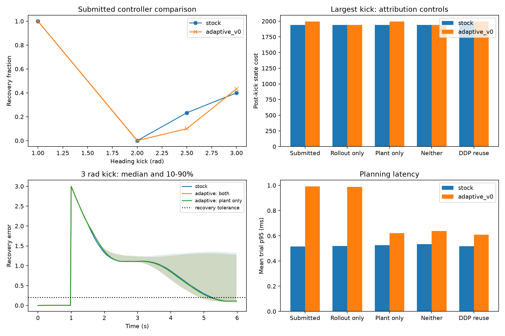

# Dubins heading-kick GPU validation

**The submitted heading-kick test does not demonstrate a useful adaptive-RMPPI advantage.** On MR head `54895c8`, the exact submitted benchmark gives **49/120 disturbed recoveries for stock and 46/120 for adaptive**, with roughly **2x adaptive planning p95**. The aggregate success difference is not statistically conclusive. Attribution controls show that the new plant-side branch repeats a DDP solve whose first action is already available, and executing that action is a different mechanism from refreshing rollout gains.

This validation covers commits `f53c75f` (plant-side action and heading benchmark) and `54895c8` (block-wide rollout barriers). It ran 1,500 timed benchmark trials in five fixed comparisons, 12 compatibility/flag smoke trials, the mechanism probe, regression suites, and CUDA sanitizer checks. The primary run uses an exact copy of the submitted source; review-only flags and higher-precision diagnostics are used for the ablations. No controller/kernel implementation was edited during validation. The previous cart-pole study evaluated the older plant execution path and is historical evidence for that implementation.

## Submitted test results

Thirty paired seeds 1000-1029 were run for nominal tracking and each heading kick, with the submitted radius 0.5 and other defaults. Success requires lateral/yaw error below 0.2 within four seconds after the kick and maintained until episode end. All episodes remain within the stated safety limits; failures below miss the recovery criterion rather than terminating at a constraint.

| Heading kick | Stock recovery | Adaptive recovery | Mean state cost: stock/adaptive | Mean trial p95: stock/adaptive |
| ---: | ---: | ---: | ---: | ---: |
| Nominal | 30/30 | 30/30 | 0.091 / 0.091 | 0.511 / 0.832 ms |
| 1 rad | 30/30 | 30/30 | 312.169 / 312.169 | 0.514 / 0.853 ms |
| 2 rad | 0/30 | 0/30 | 2304.976 / 2272.454 | 0.514 / 1.082 ms |
| 2.5 rad | 7/30 | 3/30 | 2272.689 / 2471.727 | 0.515 / 1.091 ms |
| 3 rad | 12/30 | 13/30 | 1940.854 / 1994.463 | 0.526 / 1.103 ms |

Across the four disturbed conditions, success is 40.8% stock versus 38.3% adaptive. A bootstrap over the 30 seed blocks, preserving repeated kick conditions within each seed, gives an adaptive-minus-stock success difference of **-2.5 percentage points [95% CI: -7.5, +2.5]**. This does not establish superiority or a general degradation. At 2.5 rad, four paired stock successes are lost; the exact paired binary test has p=0.125, so this small sample alone is not strong evidence of degradation. The one extra success at 3 rad is likewise not convincing evidence of improvement.

Mean trial p95 across disturbed conditions is **0.517 ms stock versus 1.032 ms adaptive**. The paired added-latency estimate is **0.515 ms [95% CI: 0.504, 0.527]**. These are averages of per-trial p95s, not pooled-cycle p95s. Absolute timing is subject to normal laptop clock variation.

There is a narrow cost benefit at 2 rad: about 1.4% lower executed state cost, with a paired difference of -32.522 [95% bootstrap CI -74.855, -0.034]. Both modes still fail its recovery deadline. This condition-specific interval is unadjusted for multiple comparisons, and the benefit is reproduced by reusing the existing DDP action. Aggregate executed-cost difference is +55.031 [95% seed-blocked CI -33.590, +148.818], so there is no overall cost advantage.

## What the attribution controls show

| Controller comparison | Disturbed recoveries: stock/adaptive | Interpretation |
| --- | ---: | --- |
| Submitted full adaptive | 49/120 / 46/120 | new plant action plus rollout gain refresh |
| Rollout refresh only, plant action off | 49/120 / 49/120 | no recovery advantage from the original rollout adaptation |
| Plant action only, rollout budget zero | 49/120 / 46/120 | reproduces the full controller's recovery counts |
| Both features off, adaptive plumbing retained | 49/120 / 49/120 | identical commands/costs to stock, but added overhead |
| Stock reuses existing DDP action vs adaptive plant-only | 46/120 / 46/120 | identical commands in all 150 paired nominal/kick trials, without another stock-side solve |

Rollout-only adaptation yields a very small consistent average cost reduction: -0.01046 [95% seed-blocked CI -0.01526, -0.00631], about **0.0006%** of stock cost, while adding about 0.506 ms to mean trial p95. It is a measurable numerical effect, but does not produce a practical recovery/compute advantage in this test.

The plant-only branch yields almost the same costs as the full submitted controller and the same success counts. In the action-reuse baseline, stock uses `DDPFeedback::result_.control_trajectory.col(0)` outside the same radius. This produces **exactly identical serialized applied-control traces and cost results** to adaptive plant-only execution across all 150 paired trials. The additional recovery solve is therefore redundant for these benchmark calls.

## Mechanism findings

### Stock already linearizes from the actual initial state

The benchmark description assumes stock feedback was linearized around a nominal zero heading and therefore has the wrong sign after a large heading kick. In this implementation, `RobustMPPIController::updateImportanceSamplingControl(state, ...)` calls `computeNominalFeedbackGains(state)`, and `DDPFeedback::computeFeedback` runs its solver from that actual `state`. The first DDP trajectory state is the real state, not the nominal zero heading.

The standalone 2.5 rad probe reports:

```text
baseline_initial_state_error=0
recovery_vs_baseline_gain_error=0
recovery_vs_baseline_ddp_action_error=0
applied_vs_recovery_action_error=0
```

This refutes the stale-nominal-linearization assumption for the applied step in this setup. It does not say that per-rollout Jacobians can never become stale later in a sampled horizon; it says this heading kick does not create the particular stock baseline defect claimed in the description.

### The new plant path substitutes an iLQR feedforward action

The recovery trajectory starts at the supplied real state, so at the applied first step:

`x - x_recovery[0] = 0`.

`getFeedbackControl` returns `u_recovery[0] + K_recovery[0]*(x-x_recovery[0]) - u_MPPI[0]`. Adding that term to the MPPI command therefore yields **u_recovery[0]**, with the gain correction zero. This is a switch to a DDP feedforward action, rather than only refreshing the gain in the earlier tracking law `u_MPPI + K_refreshed*(x-x_nominal)`.

The new behavior should be described and evaluated as a separate hybrid control policy. A benefit from it would not, by itself, validate the original per-rollout gain-refresh hypothesis. In this run it does not improve aggregate recovery, and its output can be obtained from the existing baseline DDP result without a duplicate solve.

### The one-solve-per-cycle statement is not enforced

Calling `getFeedbackControl` twice outside the radius in the same optimization cycle records `plant_refreshes_after_two_calls=2`. There is no per-cycle cache or solve-budget guard in this getter. The benchmark calls it once per cycle, so this does not inflate the reported benchmark counts. Other callers, including trajectory propagation helpers that repeatedly query feedback, can invoke additional solves. Either enforce a cycle-scoped budget/cache or document the behavior as one solve per invocation.

## Functional and synchronization validation

| Check | Result |
| --- | --- |
| CPU reference | 14/14 passed |
| Adaptive GPU suite | 4/4 passed |
| Focused diagnostics | 13/13 passed; overlaps the adaptive suite |
| Existing RMPPI controller / kernel / DDP / generic feedback | 21/21, 5/5, 10/10, 2/2 passed |
| Adaptive memcheck | 4/4 passed; 0 errors |
| Mechanism probe | passed; baseline/recovery/action identity and disabled-plant feedback verified |
| Isolated combined rollout racecheck | **0 hazards, 0 errors, 0 warnings**; previously 9 hazards |
| Two controller parity diagnostics under racecheck | numerical assertions pass; **4 errors remain** |
| Isolated combined init-eval racecheck | numerical assertion passes; **2 errors and 2 warnings** |

The block-wide rollout barrier fix clears the isolated rollout reproducer. Remaining init-eval reports involve the sampling-to-constraint handoff, state/output-to-cost handoff, and warp reduction; the controller as a whole is not yet racecheck-clean. Functional parity remains exact in the tested diagnostics. The synchronization findings and their scope are independent of whether the heading scenario establishes adaptive effectiveness.



In the last figure category, the blue bar is the stock controller with DDP-action reuse, not ordinary stock actuation. Full commands, raw/normalized traces, confidence intervals, exact submitted source, probe, and reproduction instructions are in [the artifact directory](adaptive_rmppi_validation/dubins_heading/README.md).

**Recommendation:** do not claim this benchmark validates an adaptive-RMPPI advantage. Correct the linearization/action-mechanism explanation, avoid redundant plant solves if that hybrid policy is retained, enforce or clarify its solve budget, and resolve the remaining init-eval reports. No new free-energy or stability guarantee is established by this experiment.
