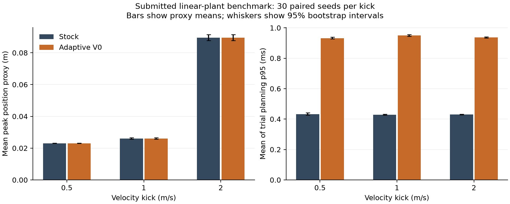

# Adaptive RMPPI GPU review and benchmark results

**Recommendation: request changes.** The submitted implementation at `fd97da2af63e3464d1f4e12288a68ecfbaef7cc9` runs on the RTX 3060, but it does not pass the plan's GPU/CPU agreement gate. A deterministic two-refresh reproduction loses an earlier refreshed gain. Two submitted GPU parity tests also fail; a stock-versus-stock control demonstrates a separate baseline reproducibility problem, so those failures cannot be attributed solely to adaptive feedback.

The submitted linear-plant benchmark completed **30 paired seeds at each of three kick severities, 180 trials and 54,000 control cycles total**. It shows no statistically distinguishable peak-error or state-cost improvement and approximately doubles planning p95. Its metrics and scenarios are insufficient to validate the nonlinear disturbance-recovery hypothesis. No improvement or real-time guarantee is established.

Only validation artifacts and documentation are changed by this review. The controller and submitted benchmark source remain unchanged so all measurements identify the reviewed implementation.

## Environment

- Review date: 2026-10-21.
- Implementation SHA: `fd97da2af63e3464d1f4e12288a68ecfbaef7cc9`; parent/baseline: `bb24b33c65e5f3528e83e806dd0370c621d96194`.
- cnpy: `91c53bc597b93992b9c92cdd92e4e50083c644a9`.
- NVIDIA GeForce RTX 3060 Laptop GPU, 6144 MiB; driver 595.99.02.
- CUDA toolkit 12.6.85, GCC 13.2.0, CMake 3.28.3, Release, C++17, sm_86.
- Existing image `trustnav:local_planner`, image SHA `591b0231a7862a814ab54a3261f64d21058fd07f7e0f58279617c30b0ccd0e0b`.
- Default MPPI CUDA barrier options. Supplemental barrier-disabled diagnostics are identified separately; the benchmark uses the defaults.
- Source mounted read-only; writable build/output directory. The stock RMPPI tests save NumPy files and require a writable working directory.
- Timing was measured on an interactive laptop with normal clock management; no concurrent build or sanitizer was running during the full benchmark. Runs execute stock before adaptive, as in the submitted source; order was not counterbalanced.

## Tests on the submitted implementation

| Check | Result |
| --- | --- |
| CPU reference | 13/13 passed |
| Adaptive GPU tests | 2/4 passed; both stock-parity tests failed |
| Existing RMPPI controller tests | 21/21 passed |
| Existing RMPPI kernel tests | 5/5 passed |
| Existing DDP tests | 10/10 passed |
| Existing generic feedback tests | 2/2 passed |
| Adaptive GPU suite under CUDA memcheck | 0 memory errors; application still exits 1 because parity assertions fail |
| CUDA racecheck on disabled parity, barrier tracking limit 4096 | exit 99; 100 hazards displayed, 116 errors, 0 warnings; reports involve both stock/adaptive rollout kernels and init-eval |
| Deterministic two-refresh GPU/CPU diagnostic | failed: CPU control -0.2 versus GPU control 0 at step 1 |
| Disabled parity with evaluation and rollout kernels pinned | failed; maximum observed absolute control difference 0.004087 by cycle 9 |
| Stock versus stock, same seed, both kernels pinned | also failed; maximum observed absolute difference 0.0001705 over 10 cycles |
| Supplemental diagnostics with CUDA barriers disabled | original GPU tests still 2/4; all three added diagnostics fail |

The initial baseline before pulling the implementation passed 38/38 existing tests and DDP device memcheck. Those baseline unit tests do not establish same-seed closed-loop reproducibility.

Logs and the isolated diagnostic source are in [adaptive_rmppi_validation](adaptive_rmppi_validation/README.md). The added diagnostics are review reproducers, outside the normal CMake test suite; failures are intentional evidence, not silently skipped assertions. The passing first-violation GPU test only compares the first trigger's timestep/distance. It does not compare complete trajectories, applied controls, mixed costs, or importance-sampling corrections.

## Review findings

### P1 Preserve previously refreshed policy segments during replay

In `adaptive_robust_mppi_controller.cu:134-138`, a second refresh replaces the rollout's sole policy ID and sets its start timestep to the new violation. `DeviceAdaptiveDDPImpl::k` then uses baseline gains for all earlier timesteps. Because replay restarts from zero, earlier refreshed gains disappear. The state used to solve the second suffix was generated with those earlier gains, so the final replay is inconsistent with that solve even though its costs are recomputed.

The isolated diagnostic supplies deterministic controls with a sample-0 acceleration at step 0 and marker gains on refresh. Both CPU and GPU refresh sample 0 at steps 1 and 2. The CPU applies -0.2 at step 1; the final GPU replay applies 0. This also reproduces with CUDA barriers disabled. Preserve a composite gain/waypoint prefix or a segment history, and compare complete replay controls, states, costs and importance-sampling terms against the CPU oracle before accepting Gate B.

### P1 The benchmark cannot measure the plan's recovery success criterion

`adaptive_rmppi_benchmark.cu:98-101` calls a trial successful when state cost stays below 1000 and states remain finite. It never checks return to a tracking tolerance by a recovery deadline. Peak error compares the next actual position with the current nominal position, excludes velocity, and includes the pre-disturbance interval. The resulting success and peak columns are proxy metrics, not the five metrics defined in the plan.

The only plant is a matched double integrator. Its dynamics Jacobians are constant, so this experiment does not test the stated failure mechanism of a nominal linearization becoming inaccurate in strongly nonlinear dynamics. Add a nominal scenario, nonlinear planner dynamics and a separate mismatched plant; align state timestamps, freeze a weighted recovery tolerance/deadline, and log per-cycle latency and budget hits. A p95 alone cannot count deadline misses.

### P2 Reject unsupported GPU trigger configurations

`AdaptiveDDPFeedback::setAdaptiveConfig` accepts `MODEL_RESIDUAL` but copies only the V0 distance radius to the GPU. The device always uses the distance test. Documentation acknowledges that V1 is CPU-only, but the public configuration silently runs V0 when callers select V1. Reject that enabled GPU configuration explicitly until it is implemented, or expose the limitation through a separate supported configuration type.

### P2 Final-pass violations are absent from budget telemetry

`adaptive_robust_mppi_controller.cu:80-96` disables recording on the final pass. In particular, an enabled configuration with `max_refreshes_per_rollout=0` records no violations or budget overflows, even when trajectories leave the radius. Violations arising only after the last permitted refresh are also hidden. The CPU oracle logs a budget-exceeded event, so the instrumentation differs. Record final-pass violations without attempting another solve and separate requested, attempted and successful refresh counts.

### Validation blocker Baseline reproducibility remains unresolved

The submitted disabled-mode and unreachable-radius tests fail at their declared tolerance. Pinning both kernel choices does not fix this. The stock-versus-stock control also fails, including in the supplemental barrier-disabled build. Racecheck also reports shared-memory hazards in the common RMPPI rollout/init-eval path, including both stock and adaptive feedback instantiations. The retained racecheck run uses `--num-cuda-barriers 4096` and has no barrier-tracking overflow warning; an earlier run with insufficient tracking capacity is excluded. This is a further unresolved concurrency finding, not evidence that all reported hazards were introduced by this PR. The cause of the parity differences has not been established; these observations are not proof that the adaptive wrapper alone causes them. Do not loosen tolerances solely to obtain passing tests. Use explicit identical control samples and direct kernel comparisons to establish the disabled path's correctness independently of closed-loop baseline variability.

The existing DDP process-exit failure mode and the unproved adaptive change-of-measure/free-energy guarantee remain documented limitations. The theoretical tracking-law consistency question also remains open; passing numerical tests alone would not resolve it.

## Submitted benchmark settings and proxy results

Invocation: `adaptive_rmppi_benchmark 30 300 benchmark.csv 0.5`. Seeds 1000-1029, fixed radius 0.5 (not tuned on evaluation outputs), 300 steps at dt=0.02 s, disturbance at step 50, velocity kicks +0.5/+1/+2 m/s in x. Horizon 50, rollouts 1024, one optimization iteration, lambda=4, alpha=0, value-function threshold 10, Gaussian standard deviation 1 for both controls. Both modes select the combined rollout kernel; evaluation kernels remain autotuned as submitted. Default actuator ranges are [-FLT_MAX, FLT_MAX] (effectively unbounded). Q=diag(500,500,100,100), R=I, Q_f=I, one DDP iteration, W=I. Refresh limits are 2 per rollout, 64 per iteration and 64 policy slots.

The submitted plant has no applied random process noise; seeds control the MPPI samples. Each trial starts at [2,0,0,1] and uses the same circle state-cost function. The table reports means across trials, including the **mean of each trial's p95**, not a pooled control-cycle percentile. Refresh load is total refreshes divided by 300 cycles. CSV survival is deliberately not renamed recovery success.

| Kick (m/s) | Mode | Survival | Mean peak position proxy (m) | Mean state cost | Mean trial p95 (ms) | Mean refreshes/cycle |
| --- | --- | --- | --- | --- | --- | --- |
| 0.5 | stock | 30/30 | 0.023079 | 888.349 | 0.433 | 0.000 |
| 0.5 | adaptive_v0 | 30/30 | 0.023074 | 888.346 | 0.932 | 8.403 |
| 1 | stock | 30/30 | 0.026046 | 922.276 | 0.429 | 0.000 |
| 1 | adaptive_v0 | 30/30 | 0.026046 | 922.227 | 0.950 | 8.498 |
| 2 | stock | 30/30 | 0.089521 | 898.863 | 0.431 | 0.000 |
| 2 | adaptive_v0 | 30/30 | 0.089519 | 898.982 | 0.937 | 8.403 |

All 30 trials survived in each cell. A two-sided Wilson 95% interval for each 30/30 survival estimate is approximately 88.6%-100%; observing no failures does not establish certainty. The paired bootstrap survival-difference interval degenerates to [0,0] for these all-success observations and should not be interpreted as proof of equivalence.

| Kick (m/s) | Adaptive minus stock peak proxy mean [95% CI], m | Adaptive minus stock state cost mean [95% CI] | Added trial p95 mean [95% CI], ms |
| --- | --- | --- | --- |
| 0.5 | -4.46e-06 [-1.1e-05, 2.02e-06] | -0.0032 [-0.1644, 0.1499] | 0.4998 [0.4943, 0.5048] |
| 1 | 3.33e-07 [-1.6e-06, 2.29e-06] | -0.0487 [-0.2107, 0.1076] | 0.5212 [0.5166, 0.5259] |
| 2 | -2.25e-06 [-5.27e-06, 6.33e-07] | 0.1186 [-0.0209, 0.2574] | 0.5061 [0.5018, 0.5104] |

Intervals use 10,000 paired bootstrap resamples over seeds, RNG seed 20261021. All peak-proxy and cost intervals include zero. Mean trial p95 is 2.16-2.22 times stock. Reported budget-overflow counters were zero in every trial; final-pass under-recording means this does not prove an absence of unmet refresh demand. Per-cycle refresh p95, fraction of budget-hit cycles, maximum cycle latency and deadline-miss count cannot be recovered from the submitted CSV.

The figure compares aggregate proxy metrics, not recovery trajectories. The submitted executable does not export trajectory or per-cycle latency traces, so a recovery plot and a true cycle-latency histogram cannot be reconstructed from this run. The raw CSV, analysis script, uncertainty calculations and logs are retained; those missing acceptance items are not marked complete.

## Acceptance status

- Phase 1 CPU reference tests pass; complete GPU/CPU cost and IS agreement is unproven.
- Disabled closed-loop parity remains unresolved, with a demonstrated stock baseline reproducibility issue.
- Gate B fails the deterministic two-refresh applied-control check.
- The provided linear benchmark has been executed at the requested seed count. It establishes measurable overhead and no detectable improvement in its proxies.
- The nonlinear/mismatched recovery benchmark and its true recovery/deadline/refresh-load metrics remain absent from this PR. These results do not settle whether a corrected nonlinear adaptive RMPPI implementation would help.
