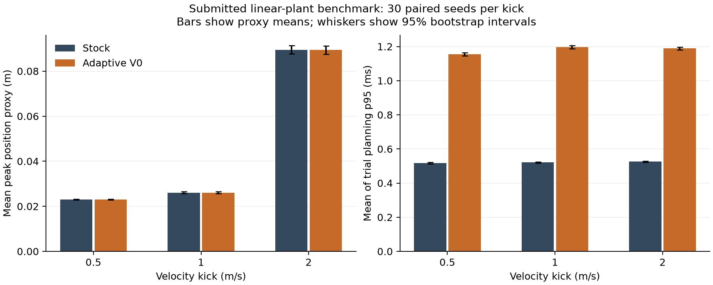

# Adaptive RMPPI follow up GPU validation

**Latest Dubins validation (`54895c8`):** [heading-kick results and mechanism controls](Adaptive_RMPPI_DUBINS_RESULTS.md). Exact submitted benchmark: stock 49/120 disturbed recoveries, adaptive 46/120, with about 2x planning p95. Rollout-only adaptation has no recovery advantage; the new plant-side action repeats an already available DDP solve. The isolated rollout racecheck is now clean, while init-eval reports remain. The earlier retests below describe their recorded implementations.

**Additional cart-pole calibration study:** [2,838-trial trigger and parameter study](Adaptive_RMPPI_CARTPOLE_STUDY.md). Calibrated radii 4/4.5 remove most nominal refreshes. On 30 fresh seeds per condition, primary recovery remains identical between stock and adaptive (61/360 under original common settings, 254/360 with cart weight 200 and force 20 N), while adaptive remains slower. This adds effectiveness evidence; the earlier controller test and racecheck results below remain unchanged.

**Latest tested MR head: `7c54a0f5e4803dfb83eb43cd43574a42e27fe2c7`.** Both benchmark executables now apply the RMPPI tracking feedback to the simulated plant. The lineinfo build and all CPU/GPU regression suites pass, including the parity checks that previously failed; adaptive memcheck is clean. The full nonlinear benchmark shows why its combined success rate was zero: at 1 rad/s, pole angle/rate recovery is 30/30 in both modes, while the cart has not met the primary cart-and-pole recovery threshold. At 2 and 3 rad/s neither mode recovers the pole. Adaptive planning remains slower and continues to use nearly all refresh budget. Lineinfo racecheck still reports shared-memory hazards.

The primary recovery definition remains unchanged: weighted cart-and-pole state error below 0.2 within 2 seconds and maintained through the trial, subject to track and pole-angle limits. A separate pole-only statistic is derived from the trace and recorded alongside it; this gives a useful diagnosis without redefining the earlier primary result. The 1 rad/s matched/mismatched scenarios each produce 30/30 pole-only recoveries in both modes, while primary combined recovery remains 0/30. At 2/3 rad/s, pole-only recovery is 0/30.

In the recovery run, adaptive mean trial p95 latency is 1.64-2.33 ms versus 0.48-0.61 ms stock, with 99.2-100% of cycles hitting its 64-refresh budget. There were no measured 20 ms deadline misses. The feedback-corrected linear benchmark again shows identical peak-error/cost averages at displayed precision and about 2.2x adaptive latency. Earlier benchmark results through `6731dcb` omitted plant-side feedback and are superseded.

Lineinfo racecheck passes its numerical assertions but reports 9 hazards in the isolated combined rollout and 22 in the two parity diagnostics together. The latest reports point to sampling/control/dynamics shared-memory handoffs rather than either modified reduction helper. Racecheck is still not clean; investigate these reports before closing the concurrency finding. Recommendation remains request changes until the reported hazards are understood and the adaptive path shows a useful recovery regime at acceptable cost.

Full results and raw traces are in [retest-7c54a0f](adaptive_rmppi_validation/retest-7c54a0f/README.md). The previous `6731dcb` and `c0f2fa7` retests remain below as historical evidence.

## Latest test results

| Suite or check | Result |
| --- | --- |
| CPU reference | 14/14 passed |
| Adaptive GPU suite | 4/4 passed |
| Expanded review diagnostics | 13/13 passed; overlaps adaptive GPU tests |
| Existing RMPPI kernels | 5/5 passed |
| Existing RMPPI controller | 21/21 passed |
| Existing DDP | 10/10 passed |
| Existing generic feedback | 2/2 passed |
| Adaptive CUDA memcheck | 4/4 passed; 0 memory errors |
| Isolated combined rollout racecheck | numerical assertion passed; 9 hazards reported with lineinfo |
| Two parity diagnostic racechecks | both numerical assertions passed; 22 hazards reported with lineinfo |

## Feedback-corrected nonlinear recovery results

| Condition | Primary recovery, stock/adaptive | Pole-only recovery, stock/adaptive | Mean trial p95, stock/adaptive (ms) | Adaptive refreshes/cycle | Budget-hit cycles |
| --- | --- | --- | ---: | ---: | ---: |
| Nominal | 30/30 / 30/30 | 30/30 / 30/30 | 0.607 / 2.331 | 63.108 | 1.000 |
| Matched kick 1 rad/s | 0/30 / 0/30 | 30/30 / 30/30 | 0.541 / 1.769 | 63.165 | 1.000 |
| Matched kick 2 rad/s | 0/30 / 0/30 | 0/30 / 0/30 | 0.503 / 1.680 | 63.142 | 1.000 |
| Matched kick 3 rad/s | 0/30 / 0/30 | 0/30 / 0/30 | 0.483 / 1.673 | 62.597 | 1.000 |
| Mismatch kick 1 rad/s | 0/30 / 0/30 | 30/30 / 30/30 | 0.504 / 1.711 | 63.201 | 1.000 |
| Mismatch kick 2 rad/s | 0/30 / 0/30 | 0/30 / 0/30 | 0.491 / 1.643 | 61.184 | 0.992 |
| Mismatch kick 3 rad/s | 0/30 / 0/30 | 0/30 / 0/30 | 0.499 / 1.642 | 62.886 | 1.000 |

Pole-only recovery uses the same 0.2 tolerance and 2-second deadline on angle plus angular velocity, with weights 1 and 0.1; it omits cart position and track-limit checks and must remain under threshold through the recorded trace. It is a secondary diagnostic, not the primary success criterion. Full paired bootstrap tables and the exact definition are in the linked artifact README.

The refresh budget saturation persists even in nominal balancing. The 1 rad/s results show pole recovery while cart recovery remains outside the primary tolerance, consistent with the metric distinction. The 2/3 rad/s cases remain too difficult for either controller to recover in this configuration. These results do not establish an adaptive recovery advantage.

## Feedback-corrected linear benchmark

| Velocity kick | Mode | Survival | Mean peak tracking error | Mean cost | Mean trial p95 (ms) | Refreshes/cycle |
| ---: | --- | ---: | ---: | ---: | ---: | ---: |
| 0.5 | stock | 30/30 | 0.023103 | 881.249 | 0.577 | 0.000 |
| 0.5 | adaptive | 30/30 | 0.023103 | 881.249 | 1.307 | 8.376 |
| 1.0 | stock | 30/30 | 0.023068 | 896.451 | 0.732 | 0.000 |
| 1.0 | adaptive | 30/30 | 0.023068 | 896.451 | 1.642 | 8.485 |
| 2.0 | stock | 30/30 | 0.051383 | 883.531 | 0.801 | 0.000 |
| 2.0 | adaptive | 30/30 | 0.051383 | 883.531 | 1.788 | 8.507 |

Both modes report identical mean outcome metrics at this precision. The adaptive path is about 2.2x slower in this linear benchmark, which cannot establish performance on nonlinear recovery.

## Earlier retests

**Latest tested MR head: `6731dcbf08cf4258af83c6bf605eaa69169cae86`.** The reported combined-kernel cost-index fix restores same-seed parity in the targeted GPU tests and passes CUDA memcheck. The full nonlinear recovery benchmark found no recovery benefit in its kicked cases and showed the adaptive path consuming its refresh cap on almost every cycle. CUDA racecheck still reports shared-memory hazards, including in an isolated combined-rollout test, so the concurrency finding remains open. Recommendation: request changes.

The new benchmark ran 30 paired seeds for nominal balancing, three matched-plant kicks and three mismatched-plant kicks. Both controllers succeeded in all nominal trials and in none of the disturbance trials. The disturbance conditions are too severe to establish adaptive effectiveness: every 2/3 rad/s kick and every mismatch trial hit a safety limit, while 1 rad/s kicks did not recover within the stated criterion. Adaptive mean trial p95 latency was 1.55-1.77 ms versus 0.48-0.49 ms stock; it hit the 64-refresh budget on 99.8-100% of cycles. No measured cycle missed the 20 ms deadline. Peak-error and cost intervals include zero.

The reported stock-vs-stock parity issue is fixed in the focused functional tests. This does not close sanitizer validation: racecheck reports 65 hazards in the stock-vs-stock diagnostic and 10 in the isolated combined rollout kernel. The new change addresses normal functional parity, while the remaining racecheck output requires investigation before concurrency can be called clean.

Current results and raw outputs are in [retest-6731dcb](adaptive_rmppi_validation/retest-6731dcb/README.md). The previous `c0f2fa7` retest is retained below as historical evidence.

## Latest test results

| Suite or check | Result |
| --- | --- |
| CPU reference | 14/14 passed |
| Submitted adaptive GPU suite | 4/4 passed |
| Expanded review diagnostics | 13/13 passed; overlaps the adaptive GPU suite |
| Existing RMPPI kernels | 5/5 passed |
| Existing RMPPI controller | 21/21 passed |
| Existing DDP | 10/10 passed |
| Existing generic feedback | 2/2 passed |
| CUDA memcheck on adaptive GPU suite | 4/4 passed; 0 errors |
| CUDA racecheck on stock-vs-stock diagnostic | numerical test passed; 65 shared-memory hazards reported |
| CUDA racecheck on isolated combined rollout kernel | numerical test passed; 10 shared-memory hazards reported |

## Recovery benchmark results

| Scenario | Severity | Mode | Recovery | Failed constraint | Mean peak error | Mean trial p95 (ms) | Max latency (ms) | Deadline misses | Refreshes/cycle | Budget-hit fraction |
| --- | ---: | --- | ---: | ---: | ---: | ---: | ---: | ---: | ---: | ---: |
| nominal | 0 | stock | 30/30 | 0 | 0.0500 | 0.483 | 0.755 | 0 | 0.000 | 0.000 |
| nominal | 0 | adaptive | 30/30 | 0 | 0.0500 | 1.546 | 3.987 | 0 | 63.108 | 1.000 |
| kick | 1 | stock | 0/30 | 0 | 0.9383 | 0.485 | 0.639 | 0 | 0.000 | 0.000 |
| kick | 1 | adaptive | 0/30 | 0 | 0.9383 | 1.616 | 3.451 | 0 | 63.191 | 1.000 |
| kick | 2 | stock | 0/30 | 30 | 5.1716 | 0.487 | 0.627 | 0 | 0.000 | 0.000 |
| kick | 2 | adaptive | 0/30 | 30 | 5.1716 | 1.721 | 3.887 | 0 | 62.158 | 1.000 |
| kick | 3 | stock | 0/30 | 30 | 2.7210 | 0.487 | 0.670 | 0 | 0.000 | 0.000 |
| kick | 3 | adaptive | 0/30 | 30 | 2.7210 | 1.673 | 3.336 | 0 | 62.771 | 1.000 |
| mismatch | 1 | stock | 0/30 | 30 | 2.8919 | 0.484 | 0.676 | 0 | 0.000 | 0.000 |
| mismatch | 1 | adaptive | 0/30 | 30 | 2.8629 | 1.729 | 4.079 | 0 | 63.003 | 0.998 |
| mismatch | 2 | stock | 0/30 | 30 | 3.3453 | 0.492 | 0.718 | 0 | 0.000 | 0.000 |
| mismatch | 2 | adaptive | 0/30 | 30 | 3.3452 | 1.690 | 4.017 | 0 | 61.465 | 0.997 |
| mismatch | 3 | stock | 0/30 | 30 | 2.6464 | 0.494 | 0.759 | 0 | 0.000 | 0.000 |
| mismatch | 3 | adaptive | 0/30 | 30 | 2.6464 | 1.771 | 4.184 | 0 | 62.979 | 1.000 |

No paired-bootstrap interval for peak error or cumulative cost excludes zero. Recovery success is identical in every condition. Adaptive's p95 latency is 3.2-3.6x stock across these scenarios. The full table, paired intervals, recovery plot, raw 420-trial CSV and per-cycle trace are in the linked artifact directory. The success-rate Wilson interval output has a tiny floating-point negative lower bound for 0/30; mathematically it is zero.

The benchmark's input grid is not yet calibrated for a useful recovery comparison: nominal balancing is already trivial for stock, while all disturbance cases yield zero recoveries. The results show that the current adaptive path is more expensive without a measured benefit in these conditions; they do not establish that no recoverable regime can benefit.

## Previous retest (`c0f2fa7`)

**Retested implementation: `c0f2fa751d368f199e4338ba9e79d77edab52df5`. Recommendation remains request changes.** The policy-prefix, telemetry, trigger-validation and kernel-selection fixes pass their targeted checks. Disabled/unreachable-radius parity and stock-versus-stock reproducibility still fail, racecheck still reports shared-memory hazards, and the submitted benchmark still does not measure the plan's nonlinear recovery criterion.

This retest covers commits `64afd3b` and `c0f2fa7`. Controller and benchmark code were not changed during retesting. The [earlier report](Adaptive_RMPPI_RESULTS.md) and its artifacts remain historical evidence for `fd97da2`; current evidence is in [retest_c0f2fa7](adaptive_rmppi_validation/retest_c0f2fa7/README.md).

## Fixes verified

| Check | Current result |
| --- | --- |
| Preserve the first refresh's policy prefix after a second refresh | passed; CPU and GPU both apply -0.2 at step 1, previously GPU applied 0 |
| Reject enabled GPU MODEL_RESIDUAL without changing existing config | passed; disabled residual configuration remains accepted |
| Report violations and overflows when refresh budget is zero | passed; one pass, zero refreshes, 256 violations and 256 overflows |
| Report unmet demand on the final replay | passed; refresh at step 1, overflow at step 2 |
| Clear last-iteration statistics when adaptation is disabled | passed |
| Select the combined kernel when enabled, even if split was selected | passed |
| Reject a combined-kernel configuration exceeding shared memory | passed |
| CPU switch from distance to model-residual triggering builds Jacobians | passed in the 14-test CPU reference suite |

The first seven checks also pass under CUDA memcheck: **7/7 passed, ERROR SUMMARY: 0 errors, exit 0**. This verifies the exercised fixes; it does not establish full GPU/CPU agreement for every trajectory, cost and importance-sampling correction.

## Regression and remaining failures

| Suite or diagnostic | Result |
| --- | --- |
| CPU reference | 14/14 passed |
| Submitted adaptive GPU suite | 2/4 passed; same two parity tests still fail |
| Existing RMPPI controller | 21/21 passed |
| Existing RMPPI kernels | 5/5 passed |
| Existing DDP | 10/10 passed |
| Existing generic feedback | 2/2 passed |
| Expanded isolated diagnostic executable | 9/13 passed; four parity/reproducibility assertions fail |
| CUDA racecheck on disabled parity | exit 99; 100 hazards displayed, 111 errors, 0 warnings |

The expanded executable includes the original four GPU tests, three earlier review diagnostics, and six new fix checks. Its counts overlap the standalone suite and are not additional independent coverage of every test. All 38 existing regressions pass.

Remaining failing tests in the expanded executable:

- `AdaptiveRMPPI.DisabledMatchesStockRMPPIWithSameSeed`
- `AdaptiveRMPPI.EnabledWithUnreachableRadiusMatchesStock`
- `AdaptiveReview.DisabledParityWithPinnedEvaluationKernels`
- `AdaptiveReview.StockMatchesStockWithPinnedKernels`

The stock-versus-stock failure still prevents attributing all parity differences specifically to adaptive feedback. The common rollout and init-eval kernel source was unchanged by the fixes. Racecheck, with `--num-cuda-barriers 4096`, still reports hazards involving both stock and adaptive feedback instantiations and init-eval. The retained run has no barrier-tracking overflow warning. The root cause of the parity differences remains unresolved; neither the failing assertions nor the racecheck reports should be relabeled as a clean baseline.

## Benchmark rerun

The unchanged submitted executable ran **30 paired seeds per severity, 180 trials, 54,000 cycles**, with arguments `30 300 benchmark.csv 0.5`. Settings remain horizon 50, 1024 rollouts, dt=0.02 s, one optimization iteration, lambda=4, alpha=0, threshold=10, Gaussian stddev=1, Q=diag(500,500,100,100), R=I, Q_f=I, W=I, one DDP iteration, and refresh budgets 2/rollout and 64/iteration with 64 slots. Seeds are 1000-1029; +x velocity kicks at cycle 50 are 0.5, 1 and 2 m/s. Both modes use the combined rollout kernel; evaluation kernels remain autotuned. Actuator limits are [-FLT_MAX, FLT_MAX].

Timing used the same RTX 3060 laptop, driver 595.99.02, CUDA toolkit 12.6.85, GCC 13.2.0, CMake 3.28.3, Release/C++17/sm_86 and default barrier configuration. Compilation and sanitizer runs finished before timing began. Normal laptop clock management and stock-before-adaptive ordering remain limitations. Exact implementation/environment identifiers are recorded in `environment.txt`.

The table retains the submitted proxy definitions. Survival is state cost below 1000 with finite states throughout, not recovery within a tolerance/deadline. Peak position compares next actual position against current nominal position, excludes velocity and includes the pre-disturbance interval. Latency is the **mean of per-trial p95s**, not a pooled cycle percentile. Refreshes/cycle is an average, not a refresh-load p95.

| Kick (m/s) | Mode | Survival | Mean peak position proxy (m) | Mean state cost | Mean trial p95 (ms) | Mean refreshes/cycle |
| --- | --- | --- | --- | --- | --- | --- |
| 0.5 | stock | 30/30 | 0.023078 | 888.357 | 0.517 | 0.000 |
| 0.5 | adaptive_v0 | 30/30 | 0.023077 | 888.374 | 1.154 | 8.403 |
| 1 | stock | 30/30 | 0.026047 | 922.357 | 0.521 | 0.000 |
| 1 | adaptive_v0 | 30/30 | 0.026045 | 922.327 | 1.197 | 8.494 |
| 2 | stock | 30/30 | 0.089520 | 898.852 | 0.525 | 0.000 |
| 2 | adaptive_v0 | 30/30 | 0.089373 | 899.032 | 1.189 | 8.404 |

| Kick (m/s) | Adaptive minus stock peak proxy mean [95% CI], m | Adaptive minus stock state cost mean [95% CI] | Added trial p95 mean [95% CI], ms | Reported overflow requests/cycle |
| --- | --- | --- | --- | --- |
| 0.5 | -5.67e-07 [-4.72e-06, 3.58e-06] | 0.0168 [-0.1042, 0.1472] | 0.6369 [0.6293, 0.6449] | 0.986 |
| 1 | -1.11e-06 [-3.29e-06, 8.74e-07] | -0.0297 [-0.2054, 0.1411] | 0.6759 [0.6675, 0.6844] | 1.110 |
| 2 | -0.000147 [-0.00044, 1e-06] | 0.1801 [-0.2237, 0.7785] | 0.6636 [0.6551, 0.6717] | 1.052 |

Intervals use 10,000 paired bootstrap resamples over seeds, RNG seed 20261021. All peak-proxy and state-cost difference intervals include zero. Both modes survive all 30 trials at every severity; each 30/30 survival estimate has a Wilson 95% interval of approximately 88.6%-100%. The degenerate all-success paired bootstrap interval does not prove equivalence.

Adaptive mode takes approximately **2.23-2.30 times** stock's mean trial p95 in this run: about 1.15-1.20 ms versus 0.52 ms. There is no statistically distinguishable improvement in the exported peak/cost proxies. Differences in absolute timing between the first review and this run are not a controlled before/after performance estimate.

Final-pass telemetry now exposes roughly 0.99-1.11 overflow requests per cycle on average; the first implementation reported zero in this benchmark. This is consistent with the targeted telemetry fix, and should not be interpreted as a measured increase in physical failures. These are request counts across passes, not the fraction of cycles hitting budget. The CSV still lacks that cycle-level fraction, refresh-load p95, maximum latency and deadline-miss count. A planning p95 below the 20 ms step interval does not establish zero deadline misses.

## Open acceptance items

The earlier policy-prefix defect is closed for the deterministic two-refresh reproducer. GPU residual-trigger rejection, final-pass/zero-budget telemetry, stale-statistics clearing and combined-kernel validation are verified for the supplied cases. The newly added CPU trigger-switch regression also passes.

The disabled-path parity and concurrency findings remain open. Complete seeded GPU/CPU trajectories, costs and importance-sampling correction agreement are still not established. A passing prefix check alone is not the complete Gate B acceptance test.

The benchmark source did not change: it still has only a matched linear double integrator, survival/position proxy metrics, and no full nominal, nonlinear or mismatched-plant recovery experiment. It does not export recovery trajectories or cycle-level timing/refresh traces. The plan's true recovery rate, deadline misses, nonlinear hypothesis, recovery plot and required load statistics therefore remain unvalidated. GPU V1 remains deliberately unsupported; the DDP exit-on-failure and unproved adaptive free-energy guarantee limitations remain.
